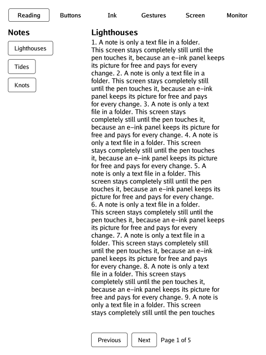

<p align="center"></p>

# Go for reMarkable

> **Note:** this project was written with an AI assistant and is pending thorough review. See the [AI disclosure](#ai-disclosure).

Go programs on the **reMarkable Paper Pro**, opened from [AppLoad](https://github.com/asivery/rm-appload).
The interface is [Go UI](https://github.com/akrck02/go-ui)'s and its shapes are
[Go Renderer](https://github.com/akrck02/go-renderer)'s; this repository holds the rest of the
platform: the program loop (`app`), the connection to the screen (`qtfb`), ink that follows the pen
(`ink`), the tablet's pen and fingers (`pen`, `pointer`), a look made for e-ink (`paper`), and tools
that build and install a program.

[](https://github.com/akrck02/go-remarkable/actions/workflows/test.yaml)
[](LICENSE)

> **Status: experiment.** The demo ran on a Paper Pro with software 3.29.1.0; what was and was not
> checked is in [what is where](docs/3-what-is-where.md#what-was-checked). Only the Paper Pro is
> supported, and a change of the tablet's software can break it.

<p align="center">
  
</p>

```bash
tools/build.sh ./cmd/hello     # out/hello
tools/install.sh out/hello     # on the tablet, over USB
```

It needs Go, and a tablet in developer mode with xovi and AppLoad. Nothing of this repository touches
the tablet's system partition. Everything is in [docs/](docs/1-overview.md); to start,
[the paper quest](docs/2-the-quest.md).

## License

MIT, in [LICENSE](LICENSE). A program built from this repository also carries the Go runtime and Go
modules; their notices are in [THIRD_PARTY_NOTICES.md](THIRD_PARTY_NOTICES.md), to keep next to any
program you share. reMarkable is a trademark of reMarkable AS; this project is not related to it.

## AI disclosure

I write most of my code by hand, so I want to be clear about this project: **it was written by an
AI assistant (Claude, by Anthropic) under my direction.** Every commit made this way carries a
`Co-Authored-By: Claude` line.

**Status: pending thorough review.** The code compiles and its tests pass, but I have not yet
reviewed it line by line. Treat it as a working draft, not as code I vouch for.
