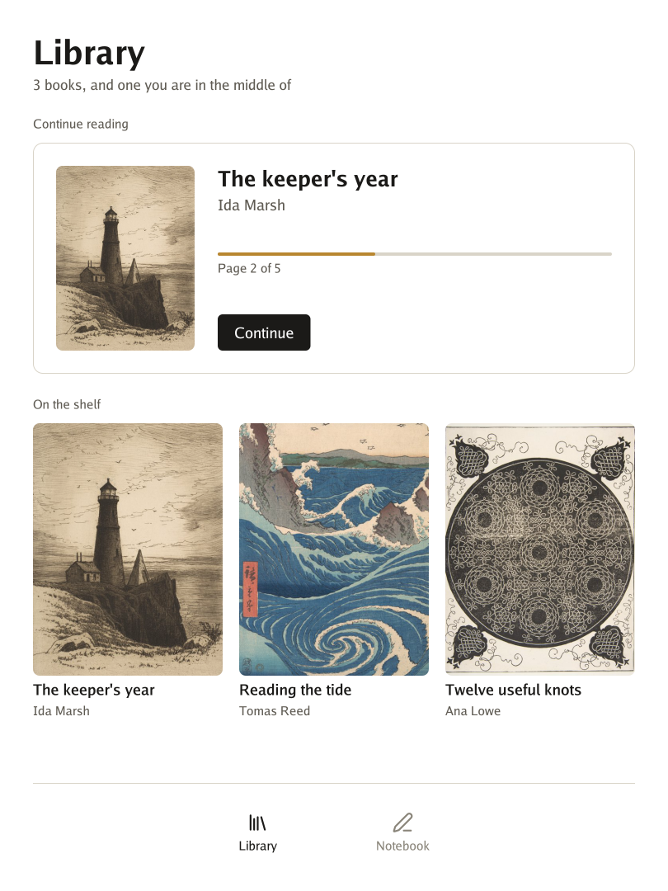

# Welcome to Go for reMarkable 👋

**Go for reMarkable runs Go programs on the reMarkable Paper Pro**: an interface on paper that stays still until you touch it, ink that follows the pen, and a screen that turns with the tablet.

It is the tablet's side of the family: the program's loop, the pen and the fingers, and the tools that put a program on the tablet. Go UI builds the interface and Go Renderer turns it into shapes. An e-ink panel has no graphics chip to speak of, so here the shapes are blended by the processor, and only the pixels that changed reach the panel.

> 🚧 **An experiment.** [What was checked](3-what-is-where.md#what-was-checked) says exactly what ran on a real tablet.

## Is it for me?

- ✅ You have a **reMarkable Paper Pro** in developer mode and want to put **your own program** on it.
- ✅ You want to see how to write for **e-ink**, where every change of the picture has a price.
- ❌ You have a reMarkable 2 or a Paper Pro Move: their screens are different, and nothing here was made for them.
- ❌ You want something that survives updates by itself: this depends on xovi and AppLoad, which follow each version of the tablet's software.

## Where to start

Pick the line that sounds like you.

| If you… | Read | Time |
|---|---|---|
| are **new** and want a program on the tablet | 📜 [The quest](2-the-quest.md): from words on paper to your own program, in 5 levels | 45 min |
| want to know **what each package does** and **what you need** | [What is where](3-what-is-where.md) | 10 min |
| plan a **larger program** | [Before writing a larger program](3-what-is-where.md#before-writing-a-larger-program) | 5 min |

## All the pages, in reading order

The menu on the left (or the files in `docs/`) follows this order.

**Start**

- [Overview](1-overview.md): this page
- [The quest](2-the-quest.md): five levels, from words on paper to turning the tablet
- [What is where](3-what-is-where.md): the packages, the tools, what you need, what was checked, and what is not done yet

## 🚧 Not done yet

See [what is where](3-what-is-where.md#not-yet).

## Words you will meet

| Word | What it means |
|---|---|
| Go | A programming language. To try these projects you install it once, from go.dev. |
| Terminal | The window where you type commands: *Terminal* on macOS and Linux, *PowerShell* on Windows. |
| Developer mode | A setting of the tablet that lets you open a terminal on it over USB, with SSH. |
| xovi | A tool that adds extensions to the tablet's own program. It stays off until you start it, and a restart turns it off again. |
| AppLoad | The xovi extension that lists and opens programs like these. |
| E-ink | A screen of tiny capsules that keeps its picture with no power, and pays for every change. |
| Refresh | The moment the panel changes its capsules. Fast ones leave a ghost of the old picture; clean ones take longer. |
| Quest | The tutorial of these docs: short levels, each ending with something that works and an achievement. |

## The family

Go for reMarkable is one of a family of small projects that work together:

| Project | What it does |
|---|---|
| [Go Renderer](https://github.com/akrck02/go-renderer) | draws 3D scenes and flat interfaces |
| [Go UI](https://github.com/akrck02/go-ui) | buttons, panels and whole applications |
| [Go UI for Android](https://github.com/akrck02/go-ui-android) | Android apps that look like Android's own |
| [Go Sound](https://github.com/akrck02/go-sound) | sound and music |
| [Go Scene Builder](https://github.com/akrck02/go-scene-builder) | 3D scenes from a flat map |
| [Go Simulator](https://github.com/akrck02/go-simulator) | simulations that change a scene |
| [Go Terrain Simulator](https://github.com/akrck02/go-simulator-terrain) | ground shaped by rivers |
| [Go Climate Simulator](https://github.com/akrck02/go-simulator-climate) | weather and biomes |
| [Go Flora Simulator](https://github.com/akrck02/go-simulator-flora) | forests that grow |
| [Go Urban Simulator](https://github.com/akrck02/go-simulator-urban) | towns that grow |
| [Go Motion Simulator](https://github.com/akrck02/go-simulator-motion) | a scene that moves |
| [Go for 3DS](https://github.com/akrck02/go-3ds) | Go on the Nintendo 3DS |
| [Go for Meta Quest](https://github.com/akrck02/go-meta-quest) | Go on the Meta Quest 3 |
| **Go for reMarkable** (this one) | Go on the reMarkable Paper Pro |

> ⚠️ All of them are **educational experiments**, written with an AI assistant and pending review by their author: good for learning and playing, not for production.
