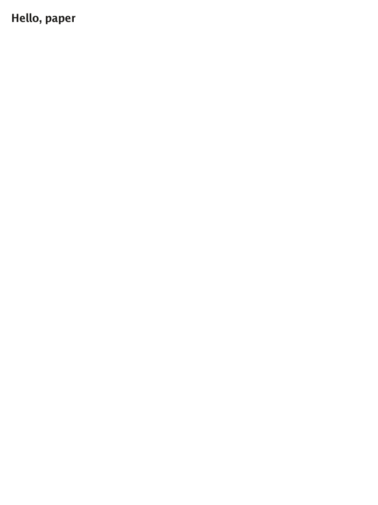
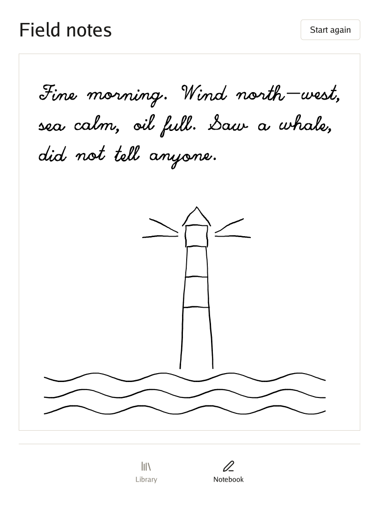
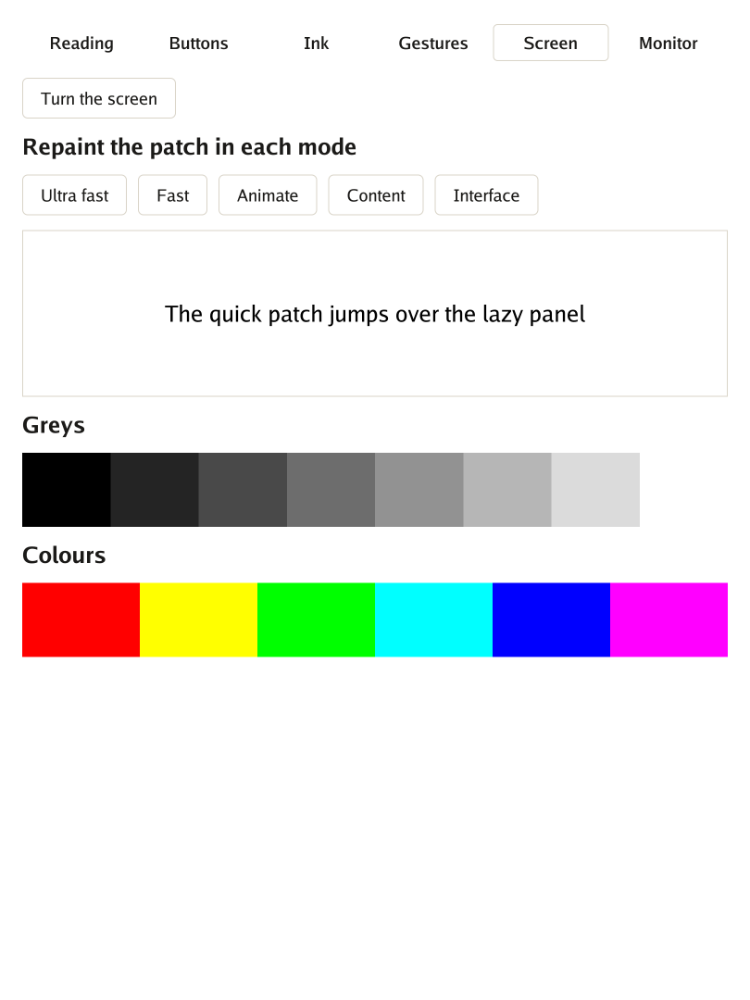

# The paper quest

Put a Go program on a reMarkable Paper Pro, one level at a time. Each level teaches one piece of Go
for reMarkable and ends with a program you open on the tablet.

We start by making the tablet ready, then put words on paper, count presses of a button without
wasting a refresh, write with the pen, and finally turn the tablet and watch the interface follow.

Every level has the same shape: **the idea**, **the code**, and a **checkpoint** to know it works.

---

## Before you start

You need:

| | Why | Where |
|---|---|---|
| **Go** 1.26 or later | The compiler; it builds for the tablet by itself | [go.dev](https://go.dev/dl/) |
| **A reMarkable Paper Pro** in developer mode, and a USB-C cable | Where it runs | The tablet's settings |
| **xovi and AppLoad** | They list and open programs | [xovi](https://github.com/asivery/xovi), [AppLoad](https://github.com/asivery/rm-appload) |

Clone the repository; Go fetches Go UI and Go Renderer by itself.

```bash
git clone https://github.com/akrck02/go-remarkable
cd go-remarkable
```

> ⚠️ **This is your tablet, at your own risk.** Follow xovi's and AppLoad's own instructions, for
> exactly your version of the tablet's software. Nothing here writes to the system partition, so
> leaving is a restart away: xovi stops, and the tablet is as it was.

Each time you restart the tablet, xovi is off. Over SSH (`ssh root@10.11.99.1`), start it like this:

```bash
systemctl mask --runtime rm-emergency.service
systemctl show rm-emergency.service -p LoadState   # must say LoadState=masked; if not, stop here
systemctl reset-failed xochitl
/home/root/xovi/start
```

The first line matters. If the tablet's own program fails while xovi is starting, the system's
reaction is an emergency restart. `--runtime` turns that reaction off only until the next restart.

**✅ Checkpoint:** after half a minute the tablet shows its usual screen, and AppLoad is in the side menu.

---

## Level 1 · Words on paper

**The idea.** AppLoad is a shelf. It looks in a folder for programs, and each one comes with a small
label, `external.manifest.json`, that gives its name. When you open one, AppLoad hands it a piece of
screen, and the program paints it.

**The code.** A program only has to say how to draw itself. This is the heart of `cmd/hello/main.go`:

```go
func newProgram(app.Device) app.Program {
	return app.Program{Draw: draw}
}

func draw(context *ui.Context) {
	context.Box(ui.Layout{Width: ui.Grow(), Height: ui.Grow(), Padding: ui.Pad(marginInLayoutPixels)}, func() {
		context.Heading("Hello, paper")
	})
}
```

`main` only calls `app.Run(newProgram)`. Build it and send it over:

```bash
tools/build.sh ./cmd/hello     # prints out/hello
tools/install.sh out/hello     # prints installed hello on root@10.11.99.1
```

Reload AppLoad's list and open *Hello, paper*.

<p align="center"></p>

**✅ Checkpoint:** the words are on the panel, and they stay there with the program asleep.

🏅 *Achievement: first ink, without a pen.*

---

## Level 2 · A button that counts

**The idea.** A phone repaints sixty times a second and nobody minds. E-ink pays for every change,
with time and with ghosts of the old picture. So the program sleeps until something happens, and it
sends only the pixels that changed. Go UI's usual button also darkens while it is held. On paper that
is a whole extra refresh before anything has happened, so `paper.Button` keeps one look.

**The code**, from `cmd/counter/main.go`:

```go
func (shown *counter) draw(context *ui.Context) {
	context.Box(ui.Layout{Direction: ui.Vertical, Width: ui.Grow(), Height: ui.Grow(), Padding: ui.Pad(marginInLayoutPixels), Gap: gapInLayoutPixels}, func() {
		context.Heading(fmt.Sprintf("Pressed %d times", shown.count))
		if paper.Button(context, addButtonName) {
			shown.count++
		}
	})
}
```

```bash
tools/build.sh ./cmd/counter && tools/install.sh out/counter
```

<p align="center"></p>

**✅ Checkpoint:** each press changes the number, once. Nothing flashes while your finger is down.

You can prove it with no tablet at all. `apptest` replaces AppLoad with a stand-in that remembers what
it was asked, and `cmd/counter/main_test.go` checks that a press costs exactly one refresh:

```bash
go test ./cmd/counter
```

🏅 *Achievement: thrifty painter.*

---

## Level 3 · Writing

**The idea.** Building a whole interface for each point of a pen would be far too slow for
handwriting. So `ink.Surface` takes the pen away from the interface and paints straight on the canvas,
in the fastest refresh mode. When the pen rests for two seconds, the lines get one clean refresh.
Your palm can rest on the panel meanwhile: while the pen writes, touches are ignored.

AppLoad does not tell a program how hard you press, so `pen` reads the pen's own device, without
taking it away from the system.

**The code**, from `cmd/notebook/main.go`. The program makes the paper, shows it, and tells the loop
that it has one:

```go
func (shown *notebook) draw(context *ui.Context) {
	context.Box(ui.Layout{Direction: ui.Vertical, Width: ui.Grow(), Height: ui.Grow(), Padding: ui.Pad(marginInLayoutPixels), Gap: gapInLayoutPixels}, func() {
		if paper.Button(context, clearButtonName) {
			shown.page.Clear()
		}
		shown.page.DrawPaper(context)
	})
}

func newProgram(device app.Device) app.Program {
	shown := &notebook{page: device.NewInk()}
	return app.Program{Draw: shown.draw, Ink: shown.page}
}
```

```bash
tools/build.sh ./cmd/notebook && tools/install.sh out/notebook
```

<p align="center"></p>

**✅ Checkpoint:** the line follows the tip. Press harder and it gets wider. Turn the pen over, and a
band shows what the eraser is about to remove; lift it and that part is gone.

🏅 *Achievement: pen pal.*

---

## Level 4 · Turn the tablet

**The idea.** The tablet already knows which way up it is. AppLoad passes that on, if the program says
in its label that it can turn:

```json
{
  "name": "Notebook",
  "application": "notebook",
  "qtfb": true,
  "supportsRotation": true
}
```

There is nothing to add to the code: `app` turns the canvas, the pen and the fingers, and the strokes
stay where they are on the panel.

One catch is easy to miss. AppLoad opens a program **in a window**, and a window turns only with
its own button. Only **in full screen** does it follow the tablet.

**✅ Checkpoint:** open the notebook, press AppLoad's full-screen button, and turn the tablet each way.
The button moves to the new top, and taps still land on it.

🏅 *Achievement: right way up, whichever that is.*

---

## Level 5 · Everything at once

**The idea.** `cmd/demo` is a test bench with one screen for each thing the tablet can do: reading,
buttons, ink, gestures, the panel's refresh modes, and a monitor of every event. It is also the example
to read for the rest of `app.Program`: `RefreshMode` picks how each frame reaches the panel, `InkOpen`
says when the paper is on screen, and `OnEvent` sees everything first.

```bash
tools/build.sh ./cmd/demo && tools/install.sh out/demo
```

<p align="center"></p>

**✅ Checkpoint:** on *Screen*, press each mode and compare what the patch leaves behind.

🏅 *Achievement: knows the panel by heart.*

---

## 🏁 Your own program

Copy `cmd/counter` to `cmd/<your-program>`, change `application` in the manifest to that same folder
name, and draw something of your own. For what an interface for paper can look like, read
`cmd/library`: a shelf, a page that stays still until it is turned, and a notebook, with real prints
for covers and nothing that moves. Before you do anything long, read
[before writing a larger program](3-what-is-where.md#before-writing-a-larger-program).
